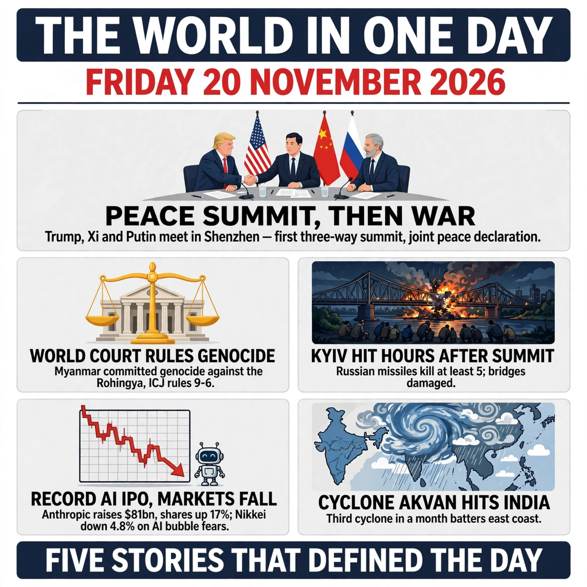

# The World in One Day — Friday 20 November 2026



One image summing up the world's news of Friday 20 November 2026, for the
make.fun bounty
[news-image-20261120](https://make.fun/bounty/news-image-20261120).

## The five stories

1. **Peace summit, then war** — Trump, Xi and Putin meet in Shenzhen, the
   first three-way summit, and sign a joint peace declaration.
2. **World Court rules genocide** — the ICJ rules 9–6 that Myanmar committed
   genocide against the Rohingya.
3. **Kyiv hit hours after summit** — Russian missiles kill at least 5 and
   damage bridges in Kyiv.
4. **Record AI IPO, markets fall** — Anthropic raises $81bn and its shares
   close up 17%, then markets slide on AI bubble fears; Japan's Nikkei falls
   4.8%.
5. **Cyclone Akvan hits India** — the third cyclone in a month batters
   India's east coast.

## How it works

`main.ts` (Node 22, standard library only) copies `entry.png` — a whole
1024×1024 PNG — to `/output/entry.png`. Running it twice writes the same
bytes both times.

```sh
mkdir -p out && MAKEFUN_OUTPUT_DIR=out node main.ts
```
